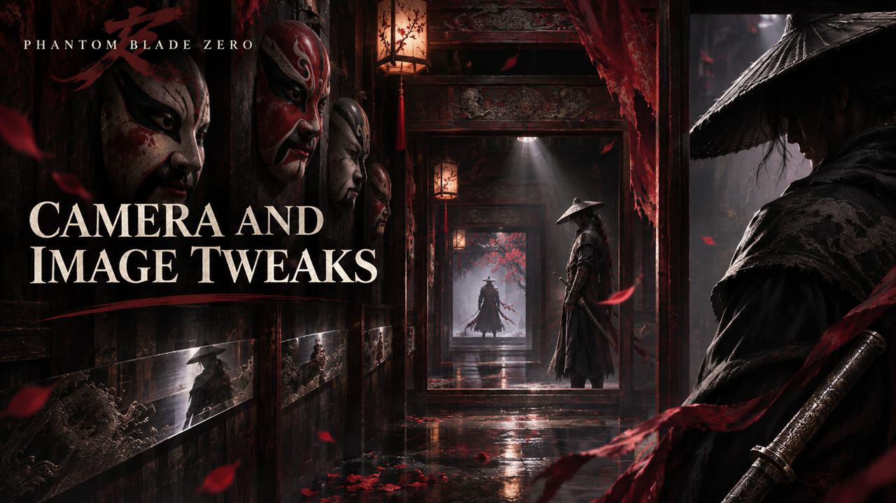

# Camera and Image Tweaks

Field of view, camera distance, ultrawide fixes, and switches for vignette, bloom, depth of field and more. Set them in game in a panel (F9) or in config.lua.

## What it does

Settings the game's own options do not have. Change them in the game in a panel (F9), or in `config.lua`; a change
shows in the running game at once (from the file: within a few seconds). As installed, every setting is at the
game's own value, so the mod changes nothing until you set something.

Camera:

- **Field of view** (50 to 130; the game's normal view is 75). Every camera view of the game is scaled by the same
  factor, so combat, lock-on and special-move views keep their zoom in proportion (the hold-deflect view, 60, becomes
  76 at 95). Cutscenes keep their own framing.
- **Camera distance** (-150 closer to +500 further back; the normal distance is 350), in every camera view, on top of
  the game's own distance changes.
- **Lock-on height** (-150 lower to +100 higher, in cm), only while the camera is in a lock-on view. Experimental.

Wide screens (wider than 16:9):

- **Ultrawide fix**: cutscene cameras no longer box the picture with black bars. Gameplay is already wide in this
  game. `"Auto"` turns it on only for screens wider than 1.9:1.
- **Ultrawide HUD**: the game keeps its HUD in a 16:9 box in the middle of the screen. `"Edges"` moves the health
  bar, quick slots and buffs out to the left edge and the weapons to the right edge; `"Halfway"` stops in between
  (for 32:9). Tips, the boss bar, subtitles and menus stay where they are.

Image effects, each on (the game's) or off:

- Chromatic aberration (colour fringes towards the screen edges)
- Vignette (darkened screen edges; off also turns film grain off)
- Depth of field (background blur; off stops every cutscene camera down to its highest f-number)
- Lens flares
- Bloom (glow around bright light)

`Enable = false` turns every tweak off at once and shows the game's own look, to compare.

It is a UE4SS Lua script: it changes the game's camera settings in memory while the game runs. It replaces no game
file and writes nothing into your save; without the mod, the next game start is the game as it was.

## Screenshots

## How to install

1. Install UE4SS for Phantom Blade Zero, for example [UE4SS](https://github.com/KintaroModding/ue4ss) (its zip
   `phantombladezero_ue4ss_<version>.zip`: the official UE4SS build with a config that makes it run in this game).
2. Download the zip of the latest release on GitHub (`phantombladezero_cameraandimagetweaks_<version>.zip`).
3. Unpack it into the game folder `platform\steam\`, next to the game's exe. It adds the folder
   `ue4ss\Mods\phantombladezero_cameraandimagetweaks\` (with the file `enabled.txt`, UE4SS starts it by itself).
4. Start the game.

To check that it runs: `platform\steam\ue4ss\UE4SS.log` has the line `[Camera and Image Tweaks] <version> loaded.`

To update the mod, replace the folder with the one of the new release; to keep your settings, put your old
`Scripts\config.lua` back (a setting that it does not have keeps its default). To remove it, delete the folder
`ue4ss\Mods\phantombladezero_cameraandimagetweaks\`.

## How to use

Press F9 in the game: a panel opens on the left side of the screen.

| Key | What it does |
|---|---|
| F9 | Open or close the panel |
| Up / Down | Choose a row |
| Left / Right | Change the row (Shift: bigger steps) |
| Home | The game's own value (press it again at once: your value comes back) |

A change works at once. The panel writes it into `config.lua` 2 seconds after your last key and when it closes, so
it stays after a restart. The row "All tweaks" turns every tweak off and on again, to compare with the game's own
look. The line under the title says what the selected tweak does right now (for the lock-on height: the camera
view the game is in).

You can also edit `config.lua` (below), while the game runs or before; the mod picks a change up within about 5
seconds. `UE4SS.log` has a line for each tweak when it turns on or off, for example
`[Camera and Image Tweaks] Field of view: on (...)`.

## Settings

The settings are in `platform\steam\ue4ss\Mods\phantombladezero_cameraandimagetweaks\Scripts\config.lua`. Open it with
a text editor, change a value and save: the mod reads the file every 5 seconds, so the game does not need a restart.
A file it cannot read (for example a typo) keeps the last settings. `UE4SS.log` shows the settings in use in the line
`[Camera and Image Tweaks] Settings: ...`, and names each value it could not use. Words (`"Auto"`, `"Edges"`...) go in
quotes.

| Setting | Default | What it does |
|---|---|---|
| `Enable` | `true` | `false`: every tweak off, the game's own look (to compare) |
| `FieldOfView` | `0` | 0 = the game's own (75 in the normal view), else 50 to 130 |
| `CameraDistance` | `0` | Added to the camera distance in every view: -150 (closer) to 500 (further back) |
| `LockOnHeight` | `0` | Only while locked on: -150 (lower) to 100 (higher), in cm; experimental |
| `UltrawideFix` | `"Off"` | `"Off"`, `"On"`, or `"Auto"` (on for screens wider than 1.9:1): no black bars in cutscenes |
| `UltrawideHUD` | `"Off"` | `"Off"`, `"Edges"` or `"Halfway"`: the HUD's sides move out towards the screen edges |
| `ChromaticAberration` | `true` | `false`: no colour fringes |
| `Vignette` | `true` | `false`: no darkened screen edges and no film grain |
| `DepthOfField` | `true` | `false`: cutscene cameras at their highest f-number, nearly no background blur |
| `LensFlares` | `true` | `false`: no lens flares |
| `Bloom` | `true` | `false`: no glow around bright light |
| `PanelKey` | `"F9"` | The key that opens the panel: `"F1"` to `"F12"` (not `"F10"`, UE4SS's console key), or `"Off"` |
| `LogDetail` | `false` | `true`: `UE4SS.log` names more of what the mod does (for tests) |

## Compatibility

- Game version: Steam build 26367565 (`CL-302256_JKS-17280`).
- Tested with UE4SS `v4.0.0`.
- Another mod that changes the field of view, the camera distance, the cutscene aspect ratio, the HUD position or
  these image effects: use only one of them for that part, or leave that setting at its default here.
- Mods that add parts to the weapon display move with it when `UltrawideHUD` moves the weapons.

## Known issues

- The ultrawide fix and the ultrawide HUD are not tested on a screen wider than 16:9 in this form yet (on a 16:9
  screen they correctly do nothing). Their game calls are those of an earlier mod of the same author.
- While the panel is open, the arrow keys and Home also reach the game (UE4SS key binds do not take a key away from
  the game).
- Lock-on height: which camera views the game uses for a lock-on is not confirmed. The mod counts every view whose
  name holds Focus, LockTarget, LockView or TargetLock; the game's Sense ability also turns the camera with a LockView
  view, so the height may apply there too.
- Depth of field off has not been checked in a cutscene yet.
- Black bars that the game draws as part of a menu or a screen widget are not covered by the ultrawide fix.

## How to build

There is nothing to build: `src\phantombladezero_cameraandimagetweaks\Scripts\main.lua` is the mod. `tests\test_main.py` runs the script
outside the game with Lua 5.4 ([lupa](https://pypi.org/project/lupa/)) and mocks of UE4SS:
`python tests\test_main.py`. `README.md` has the details.

## Credits

Made by Kintaro. MIT license: you may use, change and share this mod. UE4SS is made by the
[UE4SS-RE team](https://github.com/UE4SS-RE/RE-UE4SS). Phantom Blade Zero belongs to its makers.
